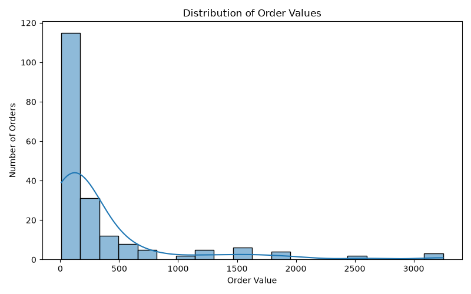
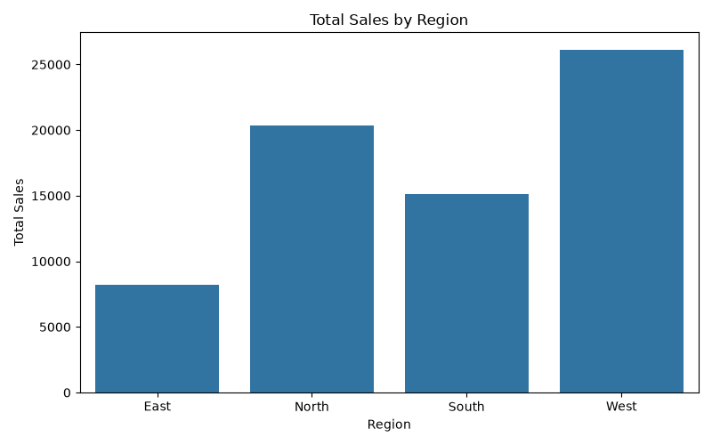
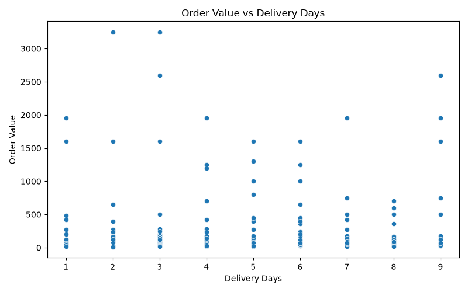
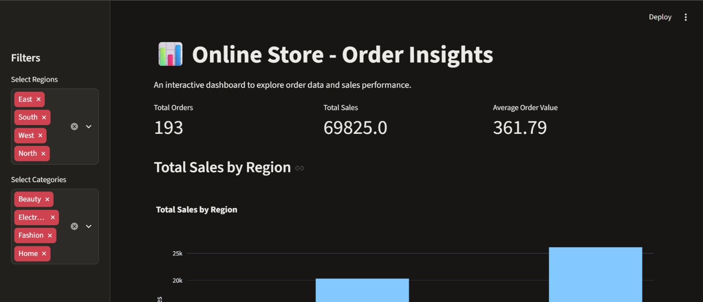

# Order Insights – Data Cleaning, Analysis and Dashboard

## Project Overview

Order Insights is a Python-based data analysis project that focuses on cleaning, analyzing and visualizing online store order data. It also includes an interactive dashboard built with Streamlit to explore sales performance and order details.

## Project Objectives

- Load and explore raw order data.
- Identify missing values, duplicate records and data inconsistencies.
- Clean and standardize the dataset.
- Generate a data quality report.
- Perform statistical and sales analysis.
- Create visualizations using Matplotlib and Seaborn.
- Build an interactive dashboard using Streamlit.

## Technologies and Libraries Used

- Python
- Pandas
- Matplotlib
- Seaborn
- Streamlit
- Plotly

## Project Structure

```text
order_insights/
│
├── data/
│   └── orders_raw.csv
│
├── output/
│   ├── cleaned.csv
│   ├── data_quality_report.csv
│   ├── order_value_histogram.png
│   ├── sales_by_region.png
│   └── order_value_vs_delivery_days.png
│
├── screenshots/
│   └── dashboard.jpeg
│
├── cleaning.py
├── app.py
├── requirements.txt
├── .gitignore
└── README.md
```

## Data Cleaning

The raw dataset was cleaned by:

- Removing extra spaces and standardizing capitalization in region and category columns.
- Converting date and numeric columns into appropriate data types.
- Removing duplicate records.
- Handling missing values in essential order columns.
- Keeping only records with positive quantity, unit price and order value.
- Preserving records with missing delivery days.

## Data Analysis

The project includes:

- Mean, median and standard deviation of order values.
- Total orders, total sales and average sales by region.
- Order counts by category.
- Cross-tabulation of regions and categories.

## Key Findings

- **Data quality:** 30 of the 223 raw rows were removed during cleaning, leaving 193 valid orders. 7 of these have no delivery days and were kept on purpose.
- **Order values are right-skewed:** the mean order value is about 361.79, while the median is only 120.00 (standard deviation about 604.50). A few very large orders pull the average up.
- **West is the top region:** it has the highest total sales (26,139) and the highest average order value (512.53). East is the lowest on both (8,214 total, 171.12 average).
- **Electronics drives revenue:** it brings in about 72% of total sales (50,320 out of 69,825) even though it has the fewest orders (45). Home has the most orders (52).
- **Delivery time does not affect order value:** the correlation between order value and delivery days is about -0.06, which is practically no relationship.
- **Order status:** 120 orders were delivered, 41 were returned and 32 were cancelled. The sales figures above include all statuses.

## Data Visualizations

Three charts were created:

### 1. Histogram of Order Values



### 2. Total Sales by Region



### 3. Order Value vs Delivery Days



## Streamlit Dashboard

The interactive dashboard includes:

- Total Orders KPI
- Total Sales KPI
- Average Order Value KPI
- Region and category filters
- Interactive sales chart
- Filtered order data table
- Download option for filtered data



## How to Run the Project

### 1. Install Dependencies

```bash
python -m pip install -r requirements.txt
```

### 2. Run Data Cleaning and Analysis

```bash
python cleaning.py
```

### 3. Launch the Streamlit Dashboard

```bash
python -m streamlit run app.py
```

## Output

The project generates a cleaned CSV dataset, a data quality report, three visualization images and an interactive Streamlit dashboard.

## Author

**Eman Haider Naqvi**


- GitHub: [https://github.com/eman-hn](https://github.com/eman-hn)
- LinkedIn: [https://www.linkedin.com/in/eman-haider-s13e13](https://www.linkedin.com/in/eman-haider-s13e13)
